# SolarOps

A multi-tenant maintenance and job-tracking platform for solar operations & maintenance
(O&M) companies, with AI built into the daily workflow.

It tracks **clients**, their **sites** (solar installations), the **recurring services** each
site needs, and every **job** from request to a signed-off **service report**, which becomes
the site's maintenance record. Customers rate each visit from a link, and AI turns those
reviews into insights.

## Screenshots

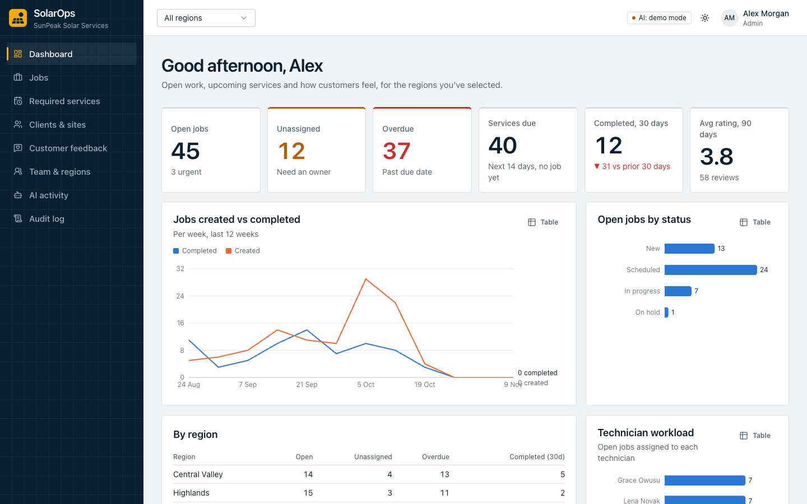

| | |
|---|---|
| 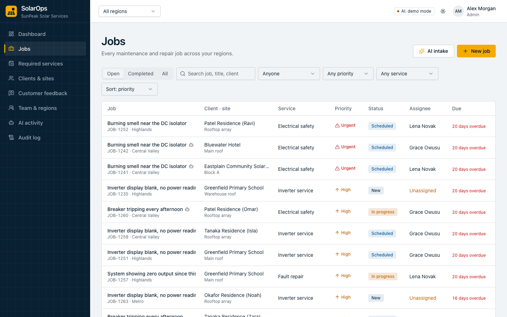<br><sub>Jobs</sub> | 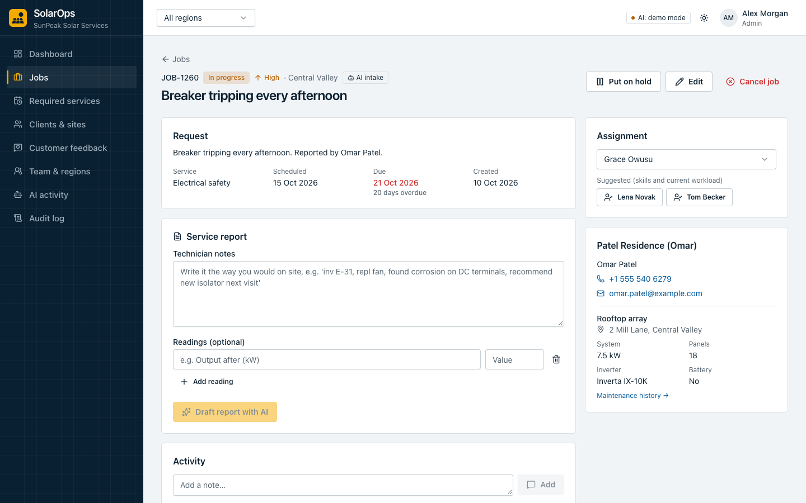<br><sub>Job detail and service report</sub> |
| 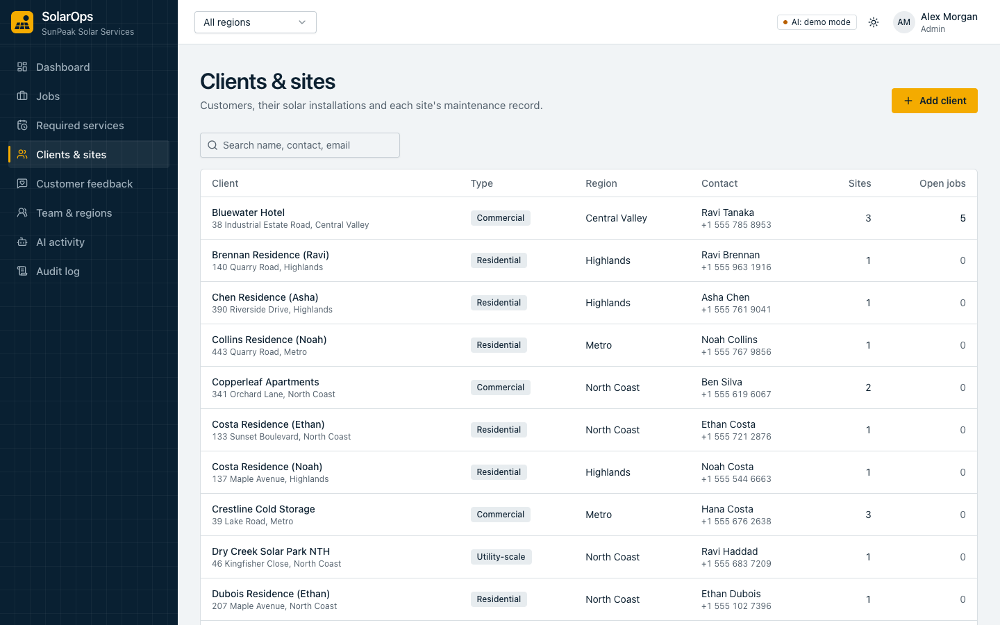<br><sub>Clients and sites</sub> | 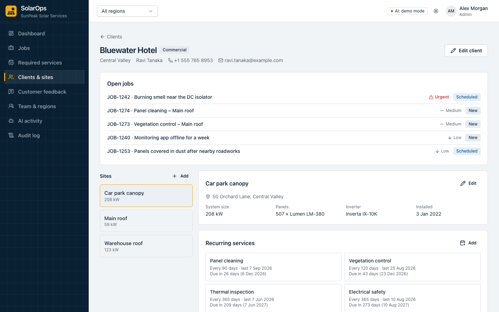<br><sub>Client, sites and recurring services</sub> |
| 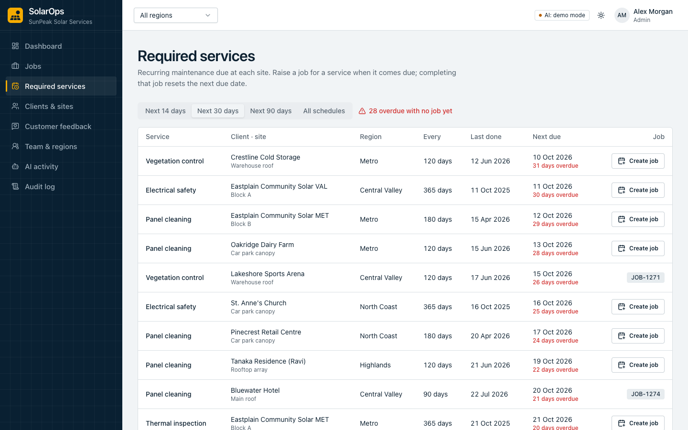<br><sub>Required services</sub> | 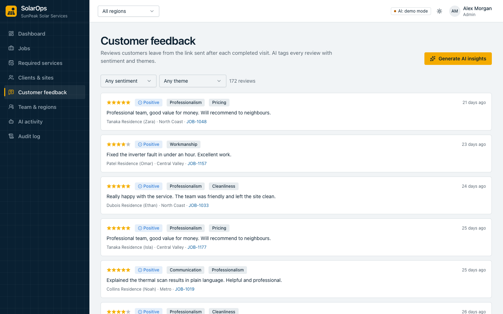<br><sub>Customer feedback</sub> |
| 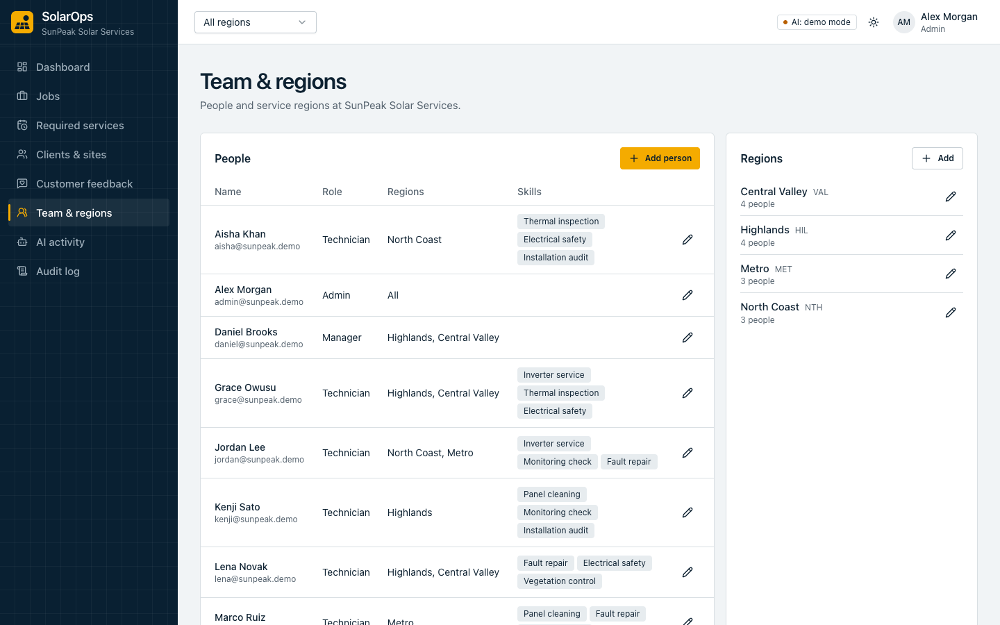<br><sub>Team and regions</sub> | 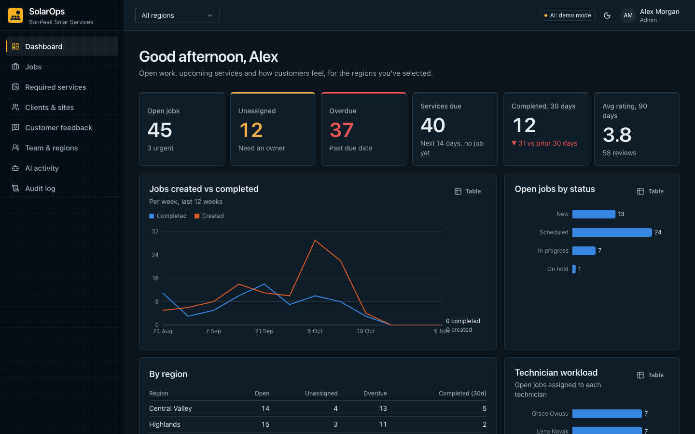<br><sub>Dark mode</sub> |
| 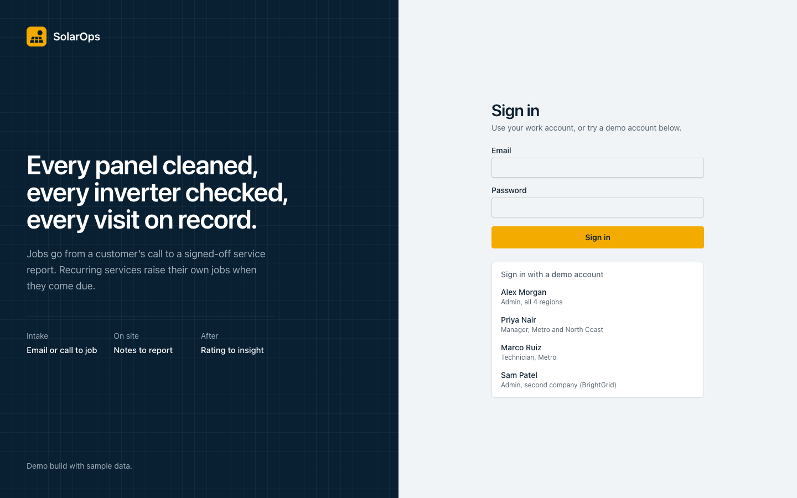<br><sub>Sign in</sub> |  |

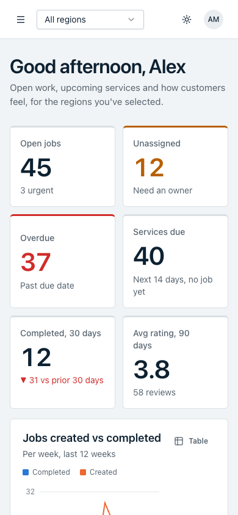

Screenshots use demo or dummy data.


## Features

**Operations**
- **Multi-tenant**: each company's data is fully isolated. Within a company, work is split by
  **region**; managers and technicians only see the regions they cover.
- **Roles**: Admin (whole company, team and regions), Manager (their regions: clients, jobs,
  assignment), Technician (their jobs; can pick up unassigned work in their region).
- **Jobs**: priorities, due dates, statuses (new → scheduled → in progress → on hold →
  completed), an activity timeline with notes, and filters by region, assignee, priority and
  service.
- **Assignment**: assign, reassign or leave a job **unassigned**. Suggested technicians are
  ranked by matching skill and current workload.
- **Required services**: recurring schedules per site (e.g. panel cleaning every 90 days).
  Raise a job when one comes due; completing it rolls the next due date forward.
- **Maintenance history**: every completed job's final report, per site.
- **Dashboard**: open, unassigned and overdue work, services coming due, weekly throughput,
  technician workload, per-region breakdown and customer sentiment. Every chart has a table
  view.

**Audit log** (admins only)
- Records every change, sign-in, failed sign-in, sign-out and refused request: who, what, which
  record, before → after values, IP address, device and result.
- Append-only: database triggers reject edits and deletes. Entries are hash-chained per company,
  and "Verify integrity" proves nothing was altered, removed or reordered.
- Filter by person, activity, outcome and date, and export to CSV. Viewing and exporting the
  log are recorded too. Managers and technicians are refused, and the attempt is logged.

**AI features** (a local LLM, with an offline fallback)
- **AI job intake**: paste a customer email, text or call notes. AI drafts the job (service
  type, priority, matched client and site, contact details) for a person to review.
- **Auto service reports**: a technician's rough field notes become a customer-ready report
  (summary, work performed, findings, recommendations), editable before it's finalized.
  It prints or saves as a PDF.
- **Customer feedback insights**: every review is tagged with sentiment and themes. On demand,
  AI summarizes what customers value, recurring complaints and suggested actions.
- **AI activity log**: every AI call is recorded with its input, output, model, latency,
  tokens and whether it fell back.

The AI never changes data on its own: its output is always a draft that a person accepts.
Model-chosen IDs (e.g. which client a message is about) are validated against what the user is
allowed to see. If the model call fails, the feature still works using rule-based logic, and
the log says so.

## Tech stack

| Layer | Technologies |
| --- | --- |
| Frontend | React 19, TypeScript, Vite, Tailwind CSS v4, Radix UI / shadcn-style components, TanStack Query, React Router, Recharts |
| Backend | Python, FastAPI, SQLAlchemy 2, Pydantic v2, JWT auth (bcrypt) |
| Database | SQLite by default; PostgreSQL via `DATABASE_URL` |
| AI | A local LLM through Ollama (Qwen2.5 by default), with schema-constrained JSON output and an offline rule-based fallback |
| Tests | pytest (tenant and region isolation, permissions, job lifecycle, AI fallback) |

## Running with Docker (Windows and macOS)

Docker keeps everything that differs between Windows and macOS (`node_modules`, Python packages, native binaries, downloaded models) inside images and Docker volumes. OneDrive then syncs only source code and data, so an update made on one machine runs on the other after one command. Needs Docker Desktop.

```bash
docker compose up -d --build      # http://localhost:8082, first start seeds demo data if backend/data is empty
```

- **Secrets:** read from `backend/.env` if it exists. Docker sets the frontend URL and CORS origins itself.
- **Data:** the database stays at `backend/data/solarops.db`, synced by OneDrive as before. Re-seed: `docker compose run --rm backend python seed.py`. Don't run the app on both machines at the same time, since they would write to the same synced SQLite file.
- **Port:** `SOLAROPS_PORT=9000 docker compose up -d`.
- **After pulling or syncing an update:** run `docker compose up -d --build` again; only the changed layers rebuild.
- **Logs:** `docker compose logs -f backend`. **Stop:** `docker compose down`.
- **Live reload while editing:** `docker compose -f docker-compose.dev.yml up --build`, then open http://localhost:5182. Code changes on either machine reload the running app. The frontend's `node_modules` lives in a Docker volume and is reinstalled only when `package-lock.json` changes.

## Running it locally

**Backend** (Python 3.12+)

```bash
cd backend
python -m venv .venv && source .venv/bin/activate   # Windows: .venv\Scripts\activate
pip install -r requirements.txt
cp .env.example .env          # optional: pick a local model (see Local AI model)
python seed.py                # demo data (resets the database)
uvicorn app.main:app --reload --port 8000
```

API docs: http://localhost:8000/docs

**Frontend** (Node 20+)

```bash
cd frontend
npm install
npm run dev                   # http://localhost:5173, proxies /api to port 8000
```

If the backend runs on another port: `API_URL=http://127.0.0.1:8010 npm run dev`.

**Tests**

```bash
cd backend && pytest
```

## Demo accounts

All use the password `SolarOps!2026`, and the login page has one-click buttons.

| Account | Role | Sees |
| --- | --- | --- |
| admin@sunpeak.demo | Admin | All 4 SunPeak regions, team and AI log |
| priya@sunpeak.demo | Manager | Metro and North Coast |
| daniel@sunpeak.demo | Manager | Central Valley and Highlands |
| marco@sunpeak.demo | Technician | Metro (their jobs, plus unassigned ones to pick up) |
| admin@brightgrid.demo | Admin | A second company, to show tenant isolation |

## Local AI model

The AI features run on a local LLM served by [Ollama](https://ollama.com), so nothing leaves
the machine and there's no per-call cost.

1. Install Ollama, then download a model once:
   `ollama pull qwen2.5:7b-instruct-q4_K_M`
   With 12 GB or more of GPU memory, `qwen2.5:14b-instruct-q4_K_M` gives noticeably better results.
2. If you use a model other than the default, set `LOCAL_LLM_MODEL` in `backend/.env`.

Each feature's answer is constrained to its JSON schema, so the model can only return data of
the right shape. Ollama runs outside Docker so it can use the GPU; the containers reach it at
`host.docker.internal`. If Ollama isn't running or the model isn't downloaded, the AI features
run in **demo mode** (rule-based), and the top bar shows which mode is active.

Settings: `AI_PROVIDER` (`auto`, `local` or `demo`), `LOCAL_LLM_URL`, `LOCAL_LLM_MODEL` and
`LOCAL_LLM_CONTEXT` (the context window in tokens, 20480 by default).

## Project layout

```
backend/
  app/
    main.py            FastAPI app
    models.py          data model (tenants, regions, users, clients, sites, schedules, jobs, reports, feedback, AI log)
    deps.py            auth + tenant/region scoping applied to every query
    routers/           auth, admin, clients/sites/schedules, jobs/reports, feedback, ai, dashboard
    services/          job rules (numbering, assignment, status, schedules) and serializers
    ai/                local LLM client + fallback, job intake, service reports, feedback analysis
  seed.py              demo data
  tests/
frontend/
  src/
    pages/             dashboard, jobs, job detail, services, clients, feedback, team, AI activity, public feedback form
    components/        layout, charts, job/report/client components, UI kit
```
